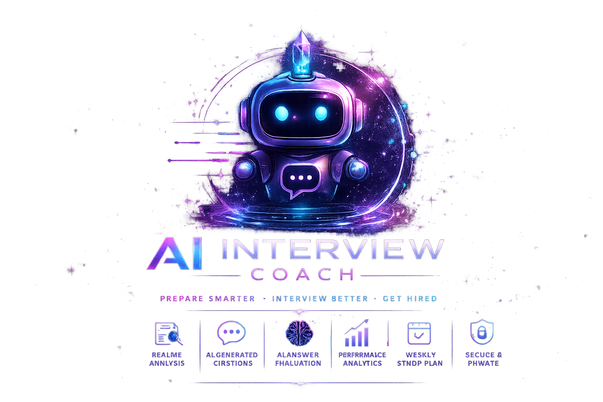

<div align="center">

<a href="https://github.com/yaren0600/AIInterviewCoach">

</a>

# AI Interview Coach

### 🤖 AI-Powered Technical Interview Preparation Platform

Prepare smarter • Interview better • Get hired

</div>

<div align="center">

# 🤖 AI Interview Coach

### **Practice. Analyze. Improve.**

An AI-powered interview preparation platform designed to help candidates
**practice technical interviews, analyze their answers, and improve their performance.**

<br>


<br><br>

> 🧠 **Your personal AI-powered interview laboratory.**

</div>

---

## ✨ About the Project

**AI Interview Coach** is a full-stack web application created to simulate a modern technical interview experience.

Instead of simply presenting predefined questions, the application is designed around an interactive workflow where users can:

**Create an interview → Answer questions → Receive AI evaluation → Analyze performance → Improve**

The project combines a **React frontend**, **ASP.NET Core Web API**, **Entity Framework Core**, **JWT authentication**, and **AI integration** into a single full-stack application.

---

## 🎯 Why AI Interview Coach?

Technical interviews can be challenging because candidates often know the subject but struggle to:

* Explain their knowledge clearly
* Structure their answers
* Identify weaknesses
* Understand what an interviewer expects
* Receive meaningful feedback after practicing

AI Interview Coach aims to provide an interactive environment where candidates can practice repeatedly and receive structured feedback.

---

# 🚀 Core Features

<div align="center">

|       🧠 AI Evaluation       |     🎯 Interview Practice    |
| :--------------------------: | :--------------------------: |
|   Analyze candidate answers  |   Create interview sessions  |
| Generate structured feedback |     Select interview type    |
|  Provide performance scores  | Generate interview questions |
|  Identify improvement areas  |   Track interview progress   |

|     🔐 Authentication    |      📊 Performance      |
| :----------------------: | :----------------------: |
| JWT-based authentication | Review interview results |
|   Secure API endpoints   | Analyze previous answers |
|    User-specific data    |  Track interview history |

</div>

---

## 🧠 AI-Powered Evaluation

The core idea of the project is to evaluate an answer based on its **meaning, relevance, and expected content**, rather than relying only on keyword matching.

### Evaluation Flow

```text
              ┌──────────────────┐
              │  Interview       │
              │    Question      │
              └────────┬─────────┘
                       │
                       ▼
              ┌──────────────────┐
              │ Candidate Answer │
              └────────┬─────────┘
                       │
                       ▼
              ┌──────────────────┐
              │   AI Evaluation  │
              └────────┬─────────┘
                       │
          ┌────────────┼────────────┐
          ▼            ▼            ▼
      📊 Score     💡 Feedback   🎯 Areas
                                  to Improve
```

The evaluation system is designed to consider:

* Question requirements
* Expected concepts
* Candidate response
* Relevance
* Completeness
* Clarity
* Technical accuracy

---

# 🏗️ System Architecture

```text
                         ┌─────────────────────┐
                         │                     │
                         │    React Frontend   │
                         │                     │
                         └──────────┬──────────┘
                                    │
                                    │ HTTP / REST
                                    ▼
                         ┌─────────────────────┐
                         │                     │
                         │  ASP.NET Core API   │
                         │                     │
                         ├─────────────────────┤
                         │ Authentication      │
                         │ Controllers         │
                         │ Business Logic      │
                         │ Interview Services  │
                         │ AI Integration      │
                         └───────┬─────┬───────┘
                                 │     │
                       ┌─────────┘     └─────────┐
                       ▼                         ▼
              ┌─────────────────┐       ┌─────────────────┐
              │                 │       │                 │
              │  SQL Database   │       │   AI Provider   │
              │                 │       │                 │
              └─────────────────┘       └─────────────────┘
```

---

# 🛠️ Tech Stack

### Backend

| Technology                | Purpose             |
| ------------------------- | ------------------- |
| **C#**                    | Backend development |
| **ASP.NET Core Web API**  | REST API            |
| **Entity Framework Core** | ORM / data access   |
| **JWT**                   | Authentication      |
| **Swagger / OpenAPI**     | API documentation   |

### Frontend

| Technology     | Purpose                   |
| -------------- | ------------------------- |
| **React**      | User interface            |
| **JavaScript** | Frontend logic            |
| **HTML5**      | Application structure     |
| **CSS3**       | Styling and responsive UI |

### Database

* SQL
* Entity Framework Core
* EF Core Migrations

### AI

The application is structured to integrate an external AI provider for:

* Answer evaluation
* Scoring
* Feedback generation
* Interview assistance

The AI layer is designed to remain independent from the core business logic so that different AI providers can be integrated in the future.

---

# 🔐 Authentication

The application uses **JWT-based authentication**.

```text
       Register / Login
              │
              ▼
      ASP.NET Core API
              │
              ▼
         JWT Token
              │
              ▼
       React Frontend
              │
              ▼
     Authenticated Requests
```

Protected endpoints require a valid authentication token.

This allows the application to keep interview sessions and results associated with the correct user.

---

# 🗄️ Database

Entity Framework Core is used as the application's ORM.

The database is responsible for storing information such as:

```text
User
 │
 ├── Interview Sessions
 │       │
 │       ├── Questions
 │       │      └── Answers
 │       │
 │       └── Evaluation Results
 │
 └── Interview History
```

Database changes are managed through Entity Framework Core migrations.

Example:

```bash
dotnet ef migrations add InitialCreate
dotnet ef database update
```

---

# 📂 Project Structure

```text
AIInterviewCoach/
│
├── Backend/
│   │
│   ├── Controllers/
│   ├── Services/
│   ├── Models/
│   ├── DTOs/
│   ├── Data/
│   ├── Migrations/
│   │
│   ├── Program.cs
│   └── appsettings.json
│
├── Frontend/
│   │
│   ├── src/
│   │   ├── components/
│   │   ├── pages/
│   │   ├── services/
│   │   └── ...
│   │
│   ├── public/
│   └── package.json
│
└── README.md
```

> The exact structure may evolve as the project continues to grow.

---

# ⚡ Getting Started

## 1️⃣ Clone the Repository

```bash
git clone https://github.com/yaren0600/AIInterviewCoach.git

cd AIInterviewCoach
```

---

## 2️⃣ Backend Setup

Navigate to the backend:

```bash
cd Backend
```

Restore dependencies:

```bash
dotnet restore
```

Configure your application settings.

Example:

```json
{
  "ConnectionStrings": {
    "DefaultConnection": "YOUR_CONNECTION_STRING"
  },
  "Jwt": {
    "Key": "YOUR_SECRET_KEY",
    "Issuer": "YOUR_ISSUER",
    "Audience": "YOUR_AUDIENCE"
  },
  "AI": {
    "ApiKey": "YOUR_AI_API_KEY"
  }
}
```

Apply database migrations:

```bash
dotnet ef database update
```

Run the backend:

```bash
dotnet run
```

---

## 3️⃣ Frontend Setup

Open another terminal:

```bash
cd Frontend
```

Install dependencies:

```bash
npm install
```

Start the development server:

```bash
npm run dev
```

---

# 📖 API Documentation

The backend provides **Swagger / OpenAPI** documentation.

Swagger allows developers to:

* Explore API endpoints
* View request and response models
* Test endpoints
* Inspect authentication requirements

After starting the backend, open the Swagger URL configured for the application.

---

# 🌐 Deployment

The project uses a separate frontend and backend architecture.

```text
             ┌──────────────────┐
             │                  │
             │  React Frontend  │
             │                  │
             └────────┬─────────┘
                      │
                      │ REST API
                      ▼
             ┌──────────────────┐
             │                  │
             │ ASP.NET Core API │
             │                  │
             └────────┬─────────┘
                      │
                      ▼
             ┌──────────────────┐
             │                  │
             │   SQL Database   │
             │                  │
             └──────────────────┘
```

### Deployment

**Frontend**

`Vercel`

**Backend**

`Render`

Production configuration should use environment variables for sensitive information.

> ⚠️ Never commit API keys, passwords, database credentials, or JWT secrets to GitHub.

---

# 🖥️ Application Preview

<div align="center">

### 🔐 Authentication

<!-- Add screenshot here -->

`Login / Register`

<br>

### 🧠 Interview Dashboard

<!-- Add screenshot here -->

`Create and manage interview sessions`

<br>

### 🎤 Interview Session

<!-- Add screenshot here -->

`Answer technical interview questions`

<br>

### 🤖 AI Evaluation

<!-- Add screenshot here -->

`Receive AI-powered feedback`

<br>

### 📊 Interview Results

<!-- Add screenshot here -->

`Review performance and improvement areas`

</div>

---

# 🔮 Roadmap

The project is continuously evolving.

### AI

* [ ] Advanced AI answer evaluation
* [ ] Multiple AI provider support
* [ ] Improved evaluation criteria
* [ ] More detailed AI feedback
* [ ] Personalized interview generation

### Interview Modes

* [ ] Technical interview mode
* [ ] Programming / coding mode
* [ ] SQL interview mode
* [ ] System design questions
* [ ] Behavioral interview mode

### Analytics

* [ ] Detailed performance dashboard
* [ ] Interview history
* [ ] Progress tracking
* [ ] Question-level analytics
* [ ] Skill-based performance analysis

### UX

* [ ] Improved interview experience
* [ ] Enhanced animations
* [ ] More interactive AI feedback
* [ ] Responsive improvements

---

# 💡 What This Project Demonstrates

AI Interview Coach brings together several areas of modern software development:

```text
        ┌───────────────────────────────┐
        │                               │
        │        Full-Stack Development │
        │                               │
        └───────────────┬───────────────┘
                        │
       ┌────────────────┼────────────────┐
       ▼                ▼                ▼
   Backend           Frontend            AI
       │                │                │
 ASP.NET Core        React          AI Integration
       │                │                │
       └────────────────┼────────────────┘
                        │
                        ▼
                 Database & API
```

Through this project, I practiced:

* Full-stack application development
* RESTful API design
* ASP.NET Core Web API
* React development
* JWT authentication
* Entity Framework Core
* Database design
* API integration
* AI service integration
* Environment-based configuration
* Frontend-backend communication
* Application deployment

---

# 🎓 Project Purpose

This project was created as a **portfolio and learning project** to explore how AI can be integrated into a practical software application.

The main focus is not only on using an AI API, but also on building the surrounding software architecture required for a real-world application:

**Authentication → API → Business Logic → Database → AI → User Experience**

---

# 👩🏻‍💻 Author

<div align="center">

### **Begüm Yaren Öztürk**

Computer Engineering Graduate
Konya Technical University

<br>

<a href="https://github.com/yaren0600">

</a>

</div>

---

<div align="center">

### ⭐ If you find this project interesting, consider giving it a star!

**Practice. Analyze. Improve.**

🤖 **AI Interview Coach**

</div>
